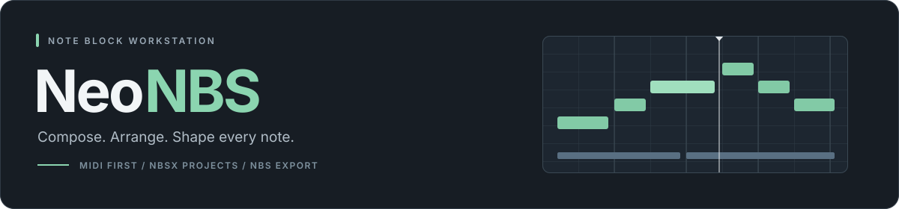
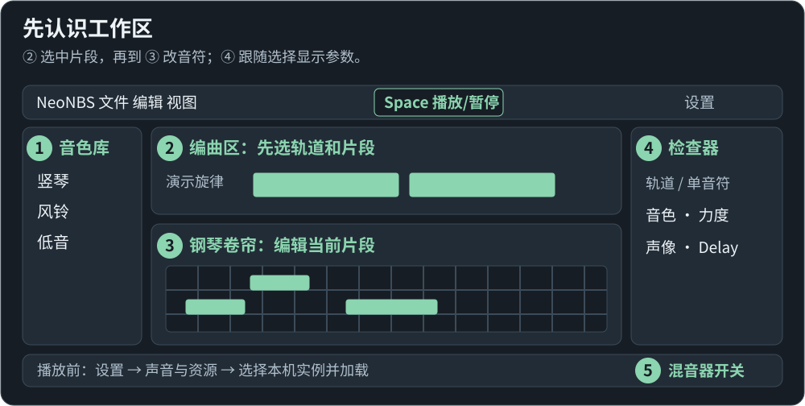
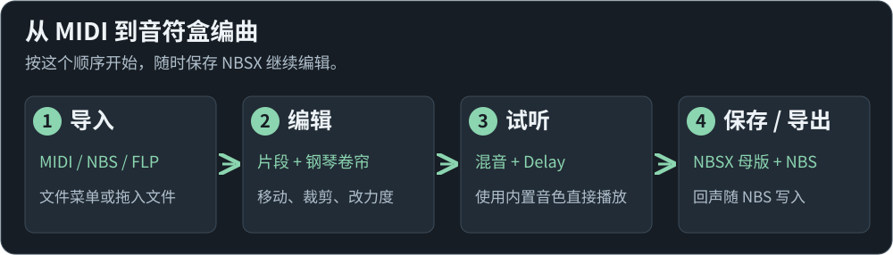
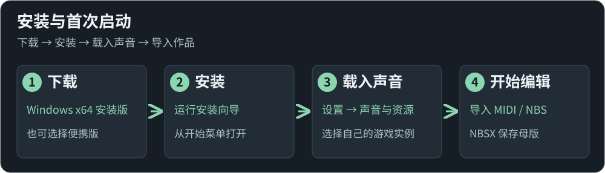

<p align="center">
  
</p>

<h1 align="center">Neo Note Block Studio</h1>

<p align="center">
  面向 Minecraft Java 版的音符盒音乐工作站<br />
  从 MIDI 开始，在编曲、钢琴卷帘和混音之间自由创作。
</p>

<p align="center">
  <a href="https://github.com/betacarr/NeoNoteBlockStudio/releases/latest"></a>
  <a href="#getting-started"></a>
  <a href="LICENSE"></a>
</p>

<p align="center">
  <a href="docs/quick-start.md">图文上手</a> ·
  <a href="#features">编辑能力</a> ·
  <a href="#formats">格式支持</a> ·
  <a href="#getting-started">快速开始</a> ·
  <a href="#documentation">使用文档</a> ·
  <a href="CHANGELOG.md">变更日志</a> ·
  <a href="https://github.com/betacarr/NeoNoteBlockStudio/issues">问题反馈</a>
</p>

---

**NeoNBS** 是独立开发的桌面音符盒编辑器，以 MIDI 导入为主要工作流，支持 Note Block Studio 的 NBS 文件互通。原生 **`.nbsx`** 工程保存片段、混音、Delay 和来源信息，让编曲过程保持可编辑。

> [!NOTE]
> **Windows x64 安装版现已提供。** 下载后即可安装运行；内置 20 种默认音色，无需安装游戏即可试听。

<a id="features"></a>

## 为音符盒编曲设计



*界面布局示意。第一次使用可从 [图文上手](docs/quick-start.md) 开始；点击图片可放大查看。*

| 工作区 | 当前能力 |
| --- | --- |
| **编曲与片段** | 可调整面板尺寸，独立复制片段、裁剪、拆分与循环；支持跨工程片段剪贴板和轨道整理。 |
| **钢琴卷帘** | 独立横向／纵向缩放，框选、移动、时值、力度、声像与单音符音色覆盖；默认 FL 操作预设，空格优先控制播放。 |
| **实时混音** | 编辑默认边改边听，显示分轨与总输出电平；轨道按乐器筛选，并与混音器对应高亮。 |
| **Delay 回声** | 按轨道派生真实音符事件，保留源 MIDI；支持时值关联 ADSR、自由尾音、固定衰减及相对原声像的左右交替，回声可写入 NBS。 |
| **音色库** | 内置原创方块图标，按音符盒垫块识别乐器；轨道默认音色与单音符覆盖分别设置。 |

### 从旋律到 NBS



[导入与试听](docs/quick-start.md#import) · [音符手势图解](docs/quick-start.md#piano) · [混音与 Delay](docs/quick-start.md#mixer) · [保存与导出图解](docs/quick-start.md#export)

<a id="formats"></a>

## 格式支持

| 格式 | 导入／打开 | 导出／保存 | 用途与范围 |
| --- | :---: | :---: | --- |
| **NBSX** | ✓ | ✓ | 原生工程格式，保存片段、混音、效果与来源信息；继续编辑时使用。 |
| **MIDI** | ✓ | ✓ | 主要输入格式；标准 MIDI 导出保留源编曲，不烘焙 Delay 回声。 |
| **NBS** | ✓ | ✓ | 与 Note Block Studio 生态互通；回声烘焙为音符事件，效果参数仍保存在 NBSX 中。 |
| **FLP** | ✓ | — | 导入可解码的音符与片段；插件、自动化及音频不重现。[范围说明](docs/flp-import.md) |

## 当前开发重点

**优先完善编辑操作与完整工作流。** 原生声音对照按版本逐步研究，游戏内结构生成待定。

- **Windows** 为主要验证平台；提供 macOS 构建入口，尚无同等运行验收。
- 默认实时试听支持编辑即时生效；原生离线对照用于声音校对，修改后需重新播放。
- 实时试听与原版声音仍可能存在差异，版本元数据和数学测试不代表所有版本、设备的游戏录音验收。

具体进度见 [当前状态](docs/status.md)，测试与人工验收边界见 [验证说明](docs/verification.md)。

<a id="getting-started"></a>

## 安装与启动



| 下载 | 适合谁 |
| --- | --- |
| **[Windows x64 安装版](https://github.com/betacarr/NeoNoteBlockStudio/releases/download/v0.1.56/NeoNBS-0.1.56-x64-setup.exe)** | 推荐。按向导安装，通过开始菜单打开 NeoNBS，可关联 NBSX 工程。 |
| [Windows x64 便携版](https://github.com/betacarr/NeoNoteBlockStudio/releases/download/v0.1.56/NeoNBS-0.1.56-x64-portable.exe) | 直接启动，适合不需要安装向导的场景。 |
| [SHA-256 校验值](https://github.com/betacarr/NeoNoteBlockStudio/releases/download/v0.1.56/SHA256SUMS.txt) | 核对下载文件。 |

下载安装版后运行向导，启动 NeoNBS；默认音色加载后即可导入 MIDI 并播放。需要核对特定游戏版本时，再到「设置 → 声音与资源」选择自己的 Minecraft 实例。具体步骤见 [图文上手](docs/quick-start.md)。

普通启动、默认试听和 Web WAV 导出无需 Minecraft、Node.js 或 Java；原生声音校对另需匹配的本机游戏资源，部分版本还需 Java 运行环境。当前安装包未做数字签名。macOS 尚未提供经实际验收的安装包。

<details>
<summary><strong>从源码开发、验证与打包（可选）</strong></summary>

需要 Git、Node.js 24+ 与 JDK 9+，建议 JDK 17。安装会下载并校验官方 Electron。

```powershell
git clone https://github.com/betacarr/NeoNoteBlockStudio.git
cd NeoNoteBlockStudio
npm ci
npm run dev
```

| 命令 | 用途 |
| --- | --- |
| `npm run dev` | 启动桌面开发环境。 |
| `npm run dev:web` | 预览 Web 界面；本机资源读取与原生渲染依赖桌面运行方式。 |
| `npm test` | 运行单元与组件测试。 |
| `npm run build` | 类型检查并构建前端与桌面代码。 |
| `npm run package:win` | 构建 Windows 分发包。 |
| `npm run package:mac` | 构建 macOS 分发包；尚无同等运行验收。 |
| `npm run audit:publication` | 检查 Git 暂存文件、版本信息与提交身份。 |

发布检查使用 Git 暂存区中的内容，提交前请先暂存计划发布的文件。它不能代替人工素材审阅。线上自动检查尚未启用，可参考 [配置模板](docs/ci-template.yml)。

</details>

<a id="documentation"></a>

## 使用文档

| 想了解什么 | 从这里开始 |
| --- | --- |
| 第一次使用，按图完成导入、编辑与导出 | **[图文上手：9 个步骤](docs/quick-start.md)** |
| 放置、移动、框选、缩放与片段边界 | [编辑操作](docs/editor-interactions.md) · [快捷键](docs/shortcuts.md) |
| 轨道筛选、实时混音与电平 | [混音器](docs/mixer.md) · [轨道管理](docs/track-management.md) |
| 回声包络、尾音、左右摆幅与效果导出 | [Delay](docs/delay-effects.md) |
| NBS 导出与音乐位置换算 | [导出流程](docs/export-workflow.md) · [音乐格点](docs/nbs-musical-timing.md) |
| 已实现的内容、历史变更与验证范围 | [当前状态](docs/status.md) · [变更日志](CHANGELOG.md) · [验证说明](docs/verification.md) |
| 版本、隐私、许可与素材 | [版本规则](VERSIONING.md) · [问题报告](SECURITY.md) · [许可说明](docs/licensing.md) · [素材边界](docs/assets-and-rights.md) |

## 许可与素材

NeoNBS 使用 **源码可见的自定义许可**，完整条款见 [LICENSE](LICENSE)，中文范围见 [许可说明](docs/licensing.md)。

- **允许**免费使用、修改和免费分发编辑器；允许用户靠自己的原创作品、接单、教学与独立服务盈利。
- **未经书面许可，禁止**销售编辑器本体或改版、收费解锁，以及收费提供在线编辑功能。
- **第三方组件**保留各自许可，见 [第三方说明](THIRD_PARTY_NOTICES.md)。本项目不属于 MIT、GPL 或 OSI 认可的开源许可。

仓库不提交 Minecraft 游戏代码、原版声音文件、贴图、专有插件或私人曲目。构建时从 OpenNBS 的固定版本获取并校验 20 种默认试听采样，随发布版提供；[来源与权利说明](third_party/opennbs-samples/NOTICE.md)单独列明。嵌入采样的 NBSX 在分享前仍需确认素材权利。README 封面和操作示意图均为原创 SVG，不含游戏素材。

> **NOT AN OFFICIAL MINECRAFT PRODUCT. NOT APPROVED BY OR ASSOCIATED WITH MOJANG OR MICROSOFT.**
