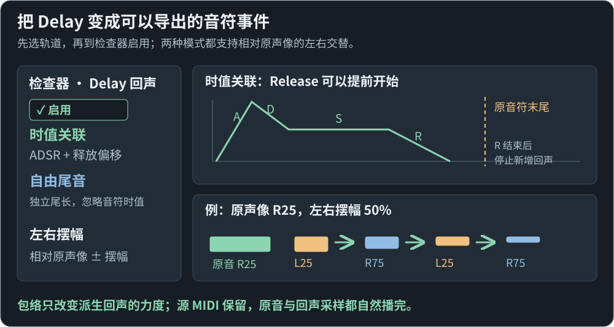

# 轨道 Delay

[图文上手：Delay](quick-start.md#delay)

1. 选轨道，在检查器中开启「Delay 回声」。
2. 选择模式，再调整间隔、衰减和包络／独立尾长。
3. 设置左右摆幅，试听后保存 NBSX；导出 NBS 时自动写入回声音符，源 MIDI 保留。

---

选中轨道后，在右侧检查器的「Delay 回声」开启效果。设置作用于该轨道的所有片段；旁路保留参数，锁定轨道后不能修改。参数和源音符一起保存在 NBSX 工程中，旧工程默认不开启。

回声是在试听、WAV 和 NBS 导出时临时展开的真实音符事件。钢琴卷帘、MIDI 源音符、控制器消息和嵌入的原始 MIDI 文件保持原样；标准 MIDI 导出也保留原始编曲，不烘焙回声。

## 两种模式

「时值关联」使用原音符的显示时值决定释放位置。A 是从零上升到峰值的时间，D 是下降到 S 的时间，S 是保持力度，R 是释放到零的时间。释放偏移相对原音符末尾：负数提前，正数延后。

释放起点为 `max(0, 原音符时值 + 释放偏移)`。若提前到 A 或 D 内，R 从当时的实际力度开始，不会突然跳到保持力度。R 结束后停止产生回声；原音和已经触发的回声采样都继续自然播放，ADSR 不控制采样的播放包络。

「自由尾音」从每个原音符起点计算独立尾长，忽略音符时值和 ADSR。尾长内每隔指定时间触发一次回声；可用来形成较密的空间尾音。

图中的虚线是原音符末尾，圆点是释放起点。选中音符时预览该音符的时值，未选时用一拍预览；图形只展示 ADSR，实际回声还会叠加固定衰减。

## 时间和力度

- 「节拍同步」以四分音符为一拍，跟随完整速度时间线；常用按钮分别为 1/4、1/8、1/16、1/32 音符。
- 「毫秒」保持真实时间间隔，不随工程变速。切换单位时，以当前预览起点的速度换算所有时间参数；超出可用范围时限制到边界。
- 「每次保留」是每次重复相对于前一次的固定力度比例。「回声力度」是整组回声的额外比例；两者都不改变原音力度。

第 n 次回声的力度因子为 `回声力度 × 每次保留^n × ADSR(回声起点)`，n 从 1 开始。自由尾音的 ADSR 因子恒为 1。例如原力度 80%、回声力度 100%、每次保留 50%，自由尾音的前四次力度为 40%、20%、10%、5%。声音仍经过所选 Minecraft 规则，高增益时沿用现有削顶规则。

数值可以输入负号和小数，Enter 或离开输入框时一次提交，Esc 取消。默认实时试听在提交后更新后续回声，无需重新播放；已经起音的采样继续自然播放。明确选择「原生离线对照」时使用预渲染快照，需要重新播放才能听到修改。

## 左右震荡

「左右摆幅」设为 0% 时关闭；大于零时，每个原音符的第 1 次回声向左、第 2 次向右，之后交替。摆幅相对原音最终声像计算：先合并音符与轨道声像并限制在 L100～R100，再给奇数次减去摆幅、偶数次加上摆幅，结果仍限制在 L100～R100。

例如原音位于 R25、摆幅为 50%，回声依次位于 L25、R75、L25、R75。原音保持 R25。每个音符及每次循环起音都独立从左开始；被 ADSR 消音的回声仍保留它的序号，不会改变后续左右顺序。两种模式、节拍和毫秒单位均支持。

该参数只改变派生回声事件的最终声像，不修改钢琴卷帘中的音符声像或 MIDI 源信息。NBSX 保存可编辑摆幅，NBS v4/v5/v6 写入每个回声的实际声像；NBS 使用整数声像，因此小数可能被舍入。旧工程缺少此参数时按 0% 处理，试听、WAV 与 NBS 采用同一份派生事件。

## 导出与边界

NBS v4/v5/v6 导出会写入回声音符的实际起音、音高、力度和声像。回声可以超出原片段边界，重叠起音会分配到独立层。导出报告列出新增回声数量；起音按所选每四分拍 8／12 格直接映射，真正非整格的细分向下取整，过小力度会被 NBS 整数力度舍入，报告会提示这些损失。文件头 TPS 的小数舍入不再改变音符位置。[音乐格点规则](nbs-musical-timing.md)。NBS 不保留可编辑的效果参数，继续编辑请保存 NBSX 母版。

循环播放保持原有工程周期，上一圈的回声可以与下一圈的原音重叠，不会因尾音而把循环周期拉长。停止会清理待播放回声。单次渲染继续受 30 分钟上限约束；每个原音符最多计划 4096 次回声，展开总事件最多 200 万，超限会报错而不会悄悄截去后半段。超过十万回声会提示处理压力。

## 验证范围

核心测试检查提前释放、零时值、零衰减、变速、循环、静音、锁定和事件上限。独立 NBS 解析器回读导出字节，检查三个版本中的回声时间和力度，以及 NBSX/MIDI 源内容不变。引擎测试检查实际渲染请求和调度回调中的事件、跨圈顺序及自然采样尾音。

开发浏览器另以真实界面输入检查启用、提前 Release、单位切换、自由尾音、旁路、撤销/重做、轨道锁定和 NBS 准备报告。0.1.37 增加左右摆幅的实际输入、保存、撤销/重做和 NBS 导出回读，源音符与嵌入资源保持一致。桌面包的保存与重开记录、测试数量和文件身份见 [0.1.37 验收](verification.md)。这些检查不增加原版游戏录音验收或 macOS 运行覆盖。

0.1.51 的综合实际界面流程另核对：5 个源音符、6 个派生回声，8／12 两网格均写出 11 个可听 NBS 事件；标准 MIDI 仍为 5 个原音符，完整 NBSX 与原始 MIDI 字节保留。[当前贯通验收](editor-workflow-audit.md)。
