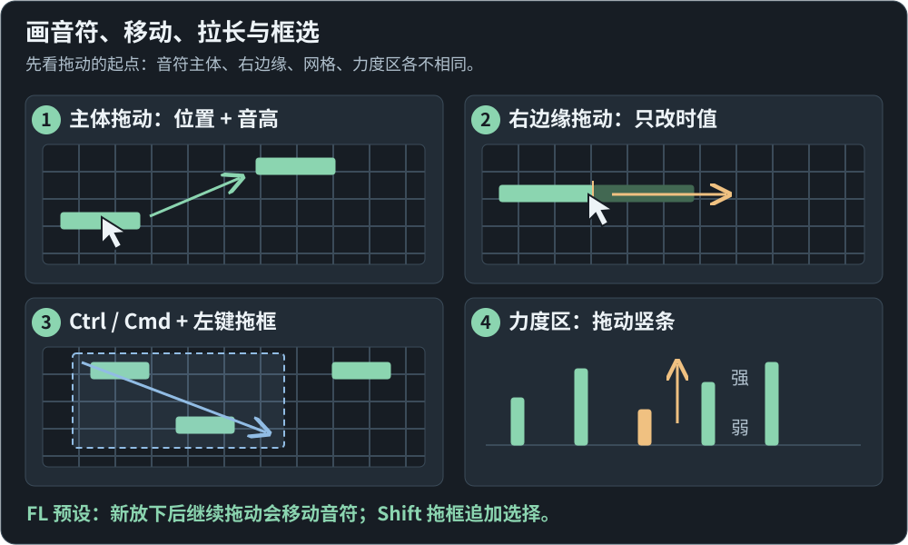
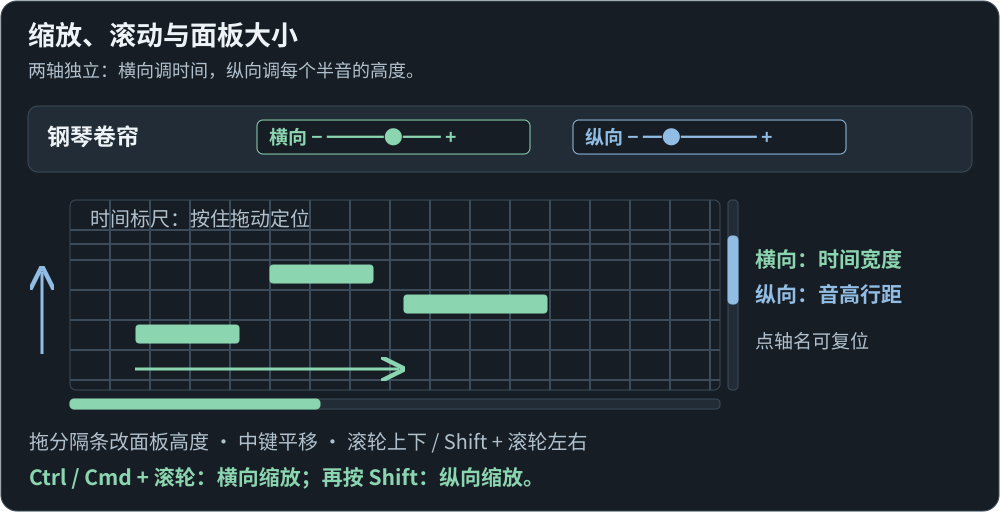
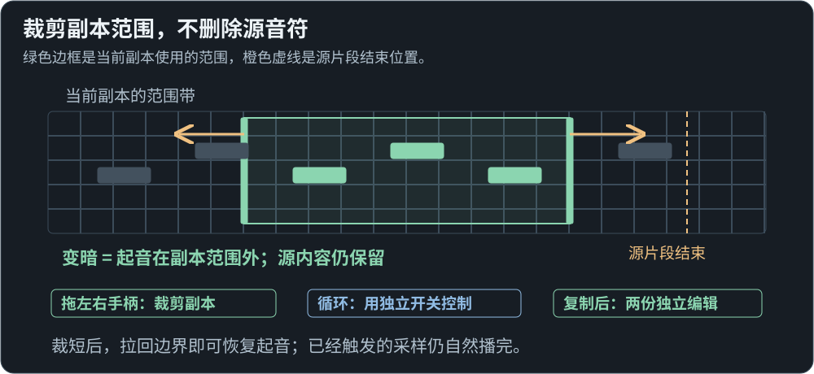
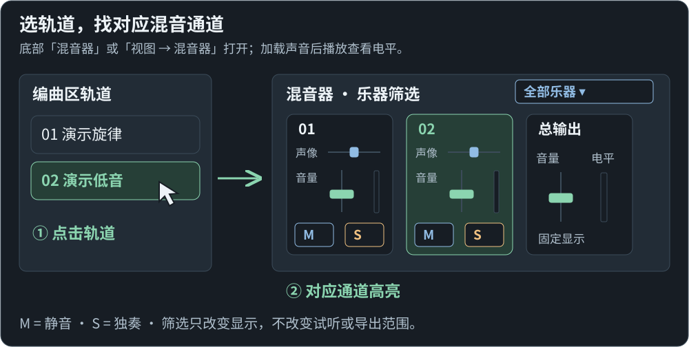
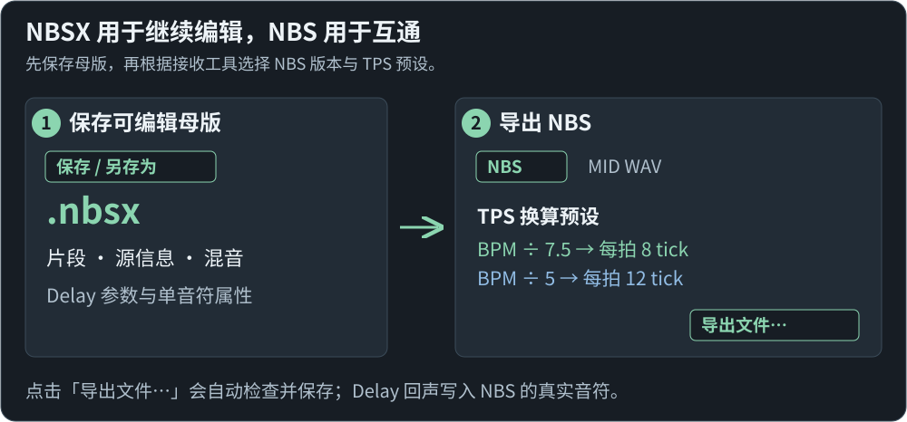
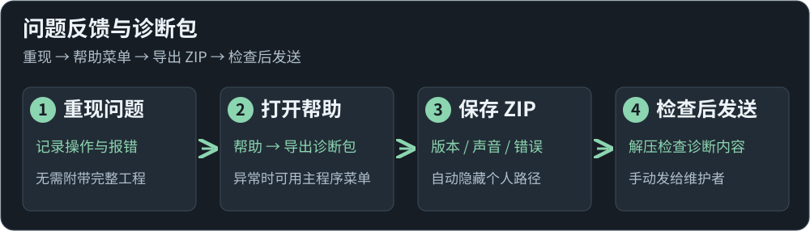

# NeoNBS 图文上手

先认清工作区，再按「导入 → 编辑 → 试听 → 保存与导出」完成第一首编曲。

以下图片是按 **0.1.57** 功能绘制的操作示意，布局作了简化；点击图片可以放大。音符均为自行制作的演示内容，不含游戏声音或私人曲目。默认使用 FL 操作预设，快捷键可在设置中修改。

[安装与启动](#install) · [认识界面](#workspace) · [导入与试听](#import) · [编辑音符](#piano) · [缩放与滚动](#view) · [裁剪片段](#regions) · [混音](#mixer) · [Delay](#delay) · [保存与导出](#export) · [反馈与日志](#diagnostics)

## 1. 安装与启动

1. 在 [下载页面](https://github.com/betacarr/NeoNoteBlockStudio/releases/latest) 选择 Windows x64 安装版，运行后按向导完成安装。
2. 从开始菜单打开 NeoNBS。也可选择便携版直接启动。
3. 已内置 20 种默认试听音色，无需安装游戏或 Java 即可播放。当前安装包未做数字签名。

## 2. 认识工作区

先在 **② 编曲区选中片段**，再到 **③ 钢琴卷帘**编辑里面的音符。**④ 检查器**会跟随当前选择，显示轨道或单音符参数。

## 3. 导入文件，准备试听

1. 点击顶部的**打开按钮（文件夹图标）**，或把 MIDI、NBS、FLP、NBSX 文件直接拖进窗口。FLP 会先显示导入确认界面。
2. 等待左侧显示「**内置音色已就绪**」，即可使用默认音色。
3. 按 **Space** 播放／暂停。编辑默认使用实时试听；界面里的按钮或输入框有焦点时，空格也优先控制播放。

默认采样随程序提供，来源与权利见[素材说明](assets-and-rights.md)。需要核对目标版本声音时，再在「设置 → 声音与资源」选择并加载本机 Minecraft 实例，另选「原生离线对照」；它使用整曲快照，修改后需重新播放。

## 4. 放置、移动、拉长和框选音符

- **放置与移动**：FL 预设下，左键放下新音符后继续拖动，会移动它的时间与音高；拖已有音符的主体同样如此。
- **改时值**：从音符的**右边缘**开始拖动。显示时值不会截断原版采样。
- **多选与力度**：Ctrl／Cmd＋左键拖框替换选择，Shift 拖框追加选择；多选后拖动力度区竖条会保留强弱差，检查器则可统一赋值。右键可擦除音符。

## 5. 调整视图，不改变音符

1. 拖钢琴标题栏的**横向／纵向滑杆**，分别调整时间比例和音高行距；点击轴名恢复该轴默认大小。
2. 拖编曲区和钢琴卷帘之间的**分隔条**调整高度；中键拖动可平移，底部与右侧滚动条也可使用。
3. 滚轮上下、Shift＋滚轮左右；Ctrl／Cmd＋滚轮横向缩放，再按 Shift 则纵向缩放。**按住时间标尺拖动**可以连续定位播放头。

## 6. 裁剪当前片段的播放范围

1. 在编曲区**单选一个片段**，拖片段边缘，或钢琴标尺下范围带的左右手柄，调整该副本的范围。
2. 范围外的起音会变暗。**裁短不删除源音符**，拉回边界即可恢复；已经起音的采样仍自然播完。
3. 循环由独立开关控制。复制出的片段各自编辑；先让编曲区获得焦点再复制片段，在钢琴区复制的则是音符。

完整的裁剪、偏移与循环规则见 [编辑操作](editor-interactions.md)，跨工程复制见 [片段剪贴板](region-clipboard.md)。

## 7. 找到对应混音通道

1. 点击底部 **混音器**，或选择 **视图 → 混音器**。
2. 点击编曲轨道或片段，对应混音通道会高亮；也能从混音器反向选中轨道。
3. 调整音量、左右声像或 **M（静音）／S（独奏）**。乐器筛选只改变显示范围，不改变播放或导出范围。

加载声音并播放后，实时试听会显示分轨和总输出电平。拖动混音参数可连续试听，松手后一次提交；更多说明见 [混音器](mixer.md)。

## 8. 添加可导出的 Delay 回声

1. **选中轨道 → 检查器 → Delay 回声 → 启用**。
2. 选「时值关联」设置 ADSR 和释放偏移，或选「自由尾音」设置独立尾长；再调整节拍／毫秒间隔、每次保留比例和回声力度。
3. 调整**左右摆幅**可让回声左右交替。例如原音 R25、摆幅 50%，回声依次为 L25、R75。

ADSR 只改变派生回声事件的力度，Release 可以提前。它不截断采样，也不主动修改源 MIDI；导出 NBS 时回声会写成真实音符。参数和边界见 [Delay](delay-effects.md)。

## 9. 先保存母版，再导出 NBS

1. 用**保存按钮**保存 `.nbsx`，保留源信息、片段、混音与效果参数。
2. 打开**导出**，选择 **NBS**、接收工具支持的 NBS 版本和 TPS 预设。默认 BPM ÷ 7.5 对应每拍 8 tick；BPM ÷ 5 对应每拍 12 tick。
3. 点击 **导出文件…**，程序会自动检查并保存；有精度或兼容问题时显示提示。NBS 包含派生回声，继续编辑仍使用 NBSX 母版。

分享嵌入采样的 NBSX 前，请确认素材的分发权利。[导出流程](export-workflow.md) · [音乐格点与精度](nbs-musical-timing.md) · [素材边界](assets-and-rights.md)

## 10. 遇到问题，导出诊断包

重现问题后选择 **帮助 → 导出诊断包…**，保存 ZIP，解压检查后再手动发送。包内提供版本、声音状态和错误记录，不附带工程或采样，不会自动上传。界面异常时仍可尝试窗口最上方的主程序帮助菜单。[记录范围与保留时间](diagnostics.md)
